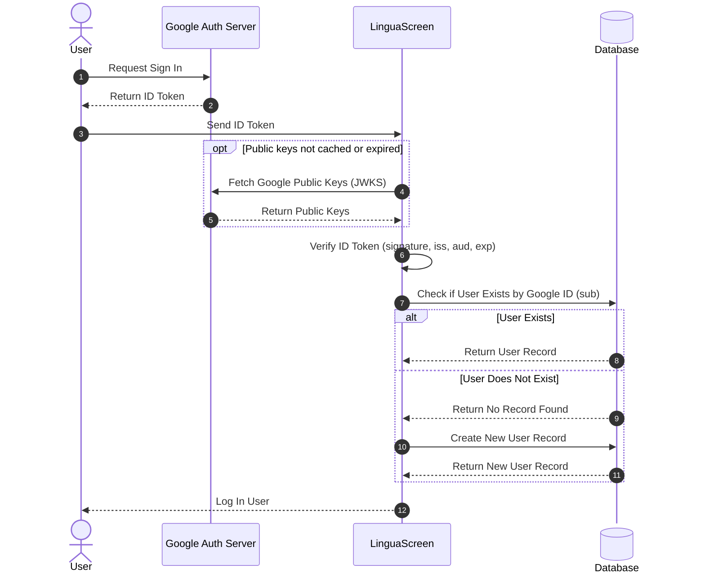

# Sign In

Google SSO

We simply store the user's Google ID and email address in our database. When the user signs in again, we check if the Google ID exists in our database. If it does, we log the user in; if not, we create a new user record.

## Flow

**ID Token Flow** instead of Authorization Code Flow because server doesn't need to act as an OAuth 2.0 client (acting on behalf of resource owner/user).

Client signs in with Google Auth Server and receives an ID Token directly (no token exchange). The ID Token is then sent to LinguaScreen for verification and user authentication.

we verify the ID token using public keys fetched from Google's JWKS endpoint. The public keys are cached and refreshed periodically to avoid unnecessary network calls.
Since it is JWT we can just infer user info (`sub`, `email`) from the verified token claims. The Google ID is the `sub` claim.




## Session

After the Google ID token is verified, LinguaScreen issues its own tokens. The Google ID token is not used again.

- Access token: JWT signed by the server (HS256), claims `sub` = user id, `exp` = 15 minutes. Sent on every request as `Authorization: Bearer <access_token>`. Verified without a database lookup.
- Refresh token: random 32 bytes, base64url, valid 30 days. Opaque, not a JWT, so it can be revoked. Stored only as a SHA-256 hash (high entropy, so a slow hash like bcrypt is not needed).

## Sign In

`POST /auth/google`

### Input

- id_token: from Google Sign-In on the device

```json
{
  "id_token": "eyJ..."
}
```

### Output

```json
{
  "access_token": "eyJ...",
  "access_token_expires_in": 900,
  "refresh_token": "Zx8...",
  "user": { "id": "...", "email": "user@example.com", "name": "..." }
}
```

Invalid or expired ID token → 401.

## Refresh

`POST /auth/refresh`

The client calls this when the access token expires (or a request returns 401).

```json
{
  "refresh_token": "Zx8..."
}
```

Returns a new access token and a new refresh token (same shape as Sign In, without `user`).

Flow:

1. Look up the token by its hash. Not found, expired → 401.
2. Already revoked → the token was reused, likely stolen. Revoke all of the user's refresh tokens, return 401. The user signs in again.
3. Revoke it and issue a new pair (rotation: every refresh token is single use)

## Sign Out

`POST /auth/sign-out` with the refresh token. Revokes it. Always 204, even if it was already revoked.

## Stored data

RefreshToken (see ERD):

- id, user id, token hash (unique), expires at, revoked at, created at

## Out of scope

- Signing out of all devices
- Cleaning up expired refresh tokens (a periodic delete, later)